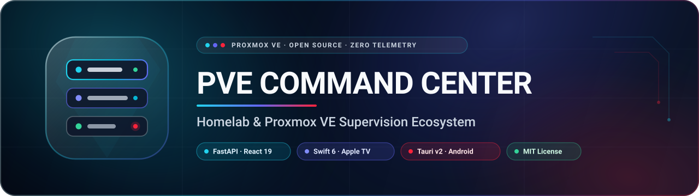

<div align="center">

  <a href="profile/README.md">
    <picture>
      <source media="(prefers-color-scheme: dark)" srcset="branding/SVG/banner-logo-solid.svg" />
      <source media="(prefers-color-scheme: light)" srcset="branding/SVG/banner-logo-light.svg" />
      
    </picture>
  </a>

  <h1><code>.github</code> — PVE Command Center Organization Meta-Repository</h1>
  <p>
    Organization overview profile, vector branding assets, community health defaults, and multi-repository push automation for <strong>PVE Command Center</strong>.
  </p>

</div>

---

## What This Repository Does

In GitHub, a repository named `.github` inside an organization or user account acts as the **organization-wide meta-repository**:

1. **Organization Overview Page ([`profile/README.md`](profile/README.md) & [`profile/README.fr.md`](profile/README.fr.md))**
   - GitHub automatically renders [`profile/README.md`](profile/README.md) as the landing README on the Organization Overview tab (`https://github.com/Fairy-Jeux`).
   - Uses `<picture>` media queries to switch seamlessly between [`branding/SVG/banner-logo-solid.svg`](branding/SVG/banner-logo-solid.svg) (dark mode) and [`branding/SVG/banner-logo-light.svg`](branding/SVG/banner-logo-light.svg) (light mode).
2. **Organization-Wide Community Health Files**
   - Any repository under the organization without its own override inherits default health files and templates from this repository:
     - [`CONTRIBUTING.md`](CONTRIBUTING.md) — Ecosystem contributor guide
     - [`CODE_OF_CONDUCT.md`](CODE_OF_CONDUCT.md) — Contributor Covenant v2.1
     - [`SECURITY.md`](SECURITY.md) — Private vulnerability disclosure & DualAuth safeguards
     - [`SUPPORT.md`](SUPPORT.md) — Documentation links & homelab support channels
     - [`.github/ISSUE_TEMPLATE/`](.github/ISSUE_TEMPLATE/config.yml) — YAML issue forms (`bug_report.yml`, `feature_request.yml`, `config.yml`)
     - [`.github/PULL_REQUEST_TEMPLATE.md`](.github/PULL_REQUEST_TEMPLATE.md) — Standard PR checklist
3. **Pure Vector Branding (`branding/SVG/`)**
   - GitHub-sanitizer-safe static SVGs (no `<script>`, `<foreignObject>`, external `<image>`, or fragile `<style>` blocks):
     - [`branding/SVG/banner-logo-solid.svg`](branding/SVG/banner-logo-solid.svg) — Dark Liquid Glass & Cider banner (`1280×360`)
     - [`branding/SVG/banner-logo-light.svg`](branding/SVG/banner-logo-light.svg) — Light Pearl Studio banner (`1280×360`)
     - [`branding/SVG/icon-logo.svg`](branding/SVG/icon-logo.svg) — Square emblem for the GitHub Organization avatar (`512×512`)
4. **Multi-Repository Bootstrap & Push Script ([`scripts/push-all-repos.sh`](scripts/push-all-repos.sh))**
   - Synchronizes `github.com/<owner>` URLs, sets `origin` across all 5 peer repositories, optionally creates missing repositories via the GitHub REST API (`GITHUB_TOKEN`), and pushes `main`.

---

## Ecosystem Repositories

| Local Directory | GitHub Repository | Description |
|---|---|---|
| `../pve-panel` | [`Fairy-Jeux/pve-panel`](https://github.com/Fairy-Jeux/pve-panel) | FastAPI server, SQLite WAL `AlertEngine`, embedded React 19 Web UI, Docker & `install.sh` |
| `../pve-center-apple` | [`Fairy-Jeux/pve-center-apple`](https://github.com/Fairy-Jeux/pve-center-apple) | Native Swift 6 / SwiftUI apps for iOS, iPadOS, macOS, and tvOS |
| `../pve-center-clients` | [`Fairy-Jeux/pve-center-clients`](https://github.com/Fairy-Jeux/pve-center-clients) | Tauri v2 (Windows / Linux) & Capacitor 8 (Android) clients |
| `../pve-center-website` | [`Fairy-Jeux/pve-center-website`](https://github.com/Fairy-Jeux/pve-center-website) | VitePress showcase landing page & bilingual EN / FR documentation portal |
| `.` (`pve-center-.github`) | [`Fairy-Jeux/.github`](https://github.com/Fairy-Jeux/.github) | This organization profile, SVG branding & default community health repository |

---

## GitHub Organization Setup Checklist

### 1. Create the `.github` Repository on GitHub

Push this directory (`pve-center-.github`) as a **public** repository named `.github` under your GitHub Organization (for example `https://github.com/Fairy-Jeux/.github`). GitHub only renders `profile/README.md` on the public Organization Overview when the `.github` repository is **public** and has a `README.md` inside `profile/`.

### 2. Set the Organization Avatar (`branding/SVG/icon-logo.svg`)

1. Open your GitHub Organization page → **Settings** → **General** → **Profile picture**.
2. Upload [`branding/SVG/icon-logo.svg`](branding/SVG/icon-logo.svg) (if GitHub's web uploader requests a raster image in your browser, export a `512×512` PNG from `branding/SVG/icon-logo.svg` via macOS Quick Look / `qlmanage -t -s 512 -o . branding/SVG/icon-logo.svg` or `rsvg-convert -w 512 -h 512 branding/SVG/icon-logo.svg -o icon-logo.png` and upload the PNG).

### 3. Enable the Verified Domain Badge

To display the green **Verified** domain badge on your GitHub Organization profile:

1. Open your GitHub Organization → **Settings** → **Verified & approved domains**.
2. Click **Add a domain** and enter your project domain (for example `pve-center.example.com` or your GitHub Pages custom domain).
3. Add the `TXT` verification record provided by GitHub (`_github-challenge-<org>`) to your DNS provider.
4. Once DNS propagates, click **Verify** in GitHub Settings — the Verified badge appears automatically next to your organization details.

---

## Using `scripts/push-all-repos.sh`

[`scripts/push-all-repos.sh`](scripts/push-all-repos.sh) prepares and pushes all 5 local peer repositories (`pve-panel`, `pve-center-apple`, `pve-center-clients`, `pve-center-website`, and `pve-center-.github`) under any GitHub Organization or user account:

```bash
# Preview actions safely without modifying files, remotes, or pushing
./scripts/push-all-repos.sh --dry-run Fairy-Jeux

# Preview migrating all URLs & remotes to a new GitHub Organization
./scripts/push-all-repos.sh --dry-run pve-center

# Create missing repos via GitHub REST API (optional) and push all 5 repos to main
export GITHUB_TOKEN="ghp_..."
./scripts/push-all-repos.sh Fairy-Jeux
```

See `./scripts/push-all-repos.sh --help` for all options (`--dry-run`, `--ssh`, `--private`).

---

## Repository Structure

```text
pve-center-.github/
├── .github/
│   ├── ISSUE_TEMPLATE/
│   │   ├── bug_report.yml
│   │   ├── config.yml
│   │   └── feature_request.yml
│   └── PULL_REQUEST_TEMPLATE.md
├── branding/
│   └── SVG/
│       ├── banner-logo-light.svg
│       ├── banner-logo-solid.svg
│       └── icon-logo.svg
├── profile/
│   ├── README.fr.md
│   └── README.md
├── scripts/
│   └── push-all-repos.sh
├── .editorconfig
├── .gitignore
├── CODE_OF_CONDUCT.md
├── CONTRIBUTING.md
├── LICENSE
├── README.md
├── SECURITY.md
└── SUPPORT.md
```

Distributed under the [MIT License](LICENSE).
