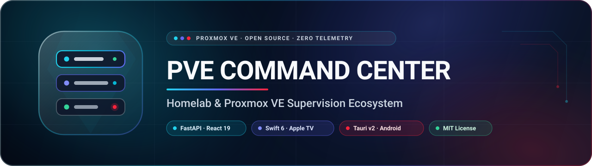

  <a href="https://github.com/Fairy-Jeux/pve-center-website">
    <picture>
      <source media="(prefers-color-scheme: dark)" srcset="../branding/SVG/banner-logo-solid.svg" />
      <source media="(prefers-color-scheme: light)" srcset="../branding/SVG/banner-logo-light.svg" />
      
    </picture>
  </a>

  

    [🇬🇧 English](README.md) | [🇫🇷 Français](README.fr.md)
  

  

    
    
    
    
  

---

**PVE Command Center** est un **écosystème open source et auto-hébergé de supervision Proxmox VE & homelab** conçu pour la réactivité, la clarté et le respect de la vie privée. Construit autour d'une esthétique Liquid Glass & Cider Studio, il réunit télémétrie temps réel des nœuds, contrôle LXC/QEMU, santé des disques MergerFS & SMART, intégrations multimédia (Jellyfin, Jellyseerr, Plex, Radarr, Sonarr, Prowlarr, qBittorrent) et moteur d'alertes multi-canaux sur tous vos écrans — du serveur déclaratif **[`pve-panel`](https://github.com/Fairy-Jeux/pve-panel)** avec son interface Web intégrée aux applications Apple natives **[`pve-center-apple`](https://github.com/Fairy-Jeux/pve-center-apple)** (iOS, iPadOS, macOS, tvOS), aux clients multiplateformes **[`pve-center-clients`](https://github.com/Fairy-Jeux/pve-center-clients)** (Windows, Linux, Android) et au portail de documentation bilingue **[`pve-center-website`](https://github.com/Fairy-Jeux/pve-center-website)**.

## Architecture & Dépôts

| Dépôt | Rôle | Stack | Plateformes |
|---|---|---|---|
| **[`pve-panel`](https://github.com/Fairy-Jeux/pve-panel)** | Serveur central, API REST / WS / SSE, `AlertEngine` SQLite WAL, découverte Bonjour mDNS, relais d'appairage chiffré, Web UI intégrée, Docker & `install.sh` | Python 3.12, FastAPI, Pydantic v2, SQLite WAL, React 19, Vite, Tailwind | Linux, LXC Proxmox VE, Docker, Web / PWA |
| **[`pve-center-apple`](https://github.com/Fairy-Jeux/pve-center-apple)** | Applications Apple natives avec interface Liquid Glass, thèmes Cider, MenuBarExtra, Opérations Live et tableau de bord Apple TV | Swift 6, SwiftUI, SwiftData, CryptoKit, Network.framework | iOS, iPadOS, macOS, tvOS |
| **[`pve-center-clients`](https://github.com/Fairy-Jeux/pve-center-clients)** | Clients desktop et mobile multiplateformes avec zone de notification système, support LAN HTTP et URL serveur configurable | Tauri v2 (Rust), Capacitor 8, React 19, TypeScript, Vite | Windows, Linux (AppImage / DEB), Android |
| **[`pve-center-website`](https://github.com/Fairy-Jeux/pve-center-website)** | Site vitrine, hub de téléchargement multiplateforme, aperçu des thèmes Cider et portail de documentation technique FR / EN | VitePress, Vue 3, CSS Liquid Glass / Cider | Web (GitHub Pages) |

### Fonctionnement de l'écosystème

- **Plan de contrôle central ([`pve-panel`](https://github.com/Fairy-Jeux/pve-panel))** : Agrège la télémétrie de l'API Proxmox VE, les montages `/host_mnt` MergerFS & disques SMART, 5 connecteurs extensibles (`http_rest`, `tcp_port`, `icmp_ping`, `json_metrics`, `webhook_ingest`), et diffuse les événements en temps réel via WebSocket (`/api/ws/events`) et SSE (`/api/events/stream`).
- **Découverte zéro-configuration** : Publie le service `_pvecenter._tcp.local.` via Bonjour/mDNS et génère des liens QR `pvecenter://connect` afin que les applications compagnon détectent votre serveur en quelques secondes.
- **Alertes multi-canaux** : Enregistre les états d'incident dans SQLite WAL avec *debouncing*, *cooldown*, mise en sourdine (`Mute`) et reprise automatique `DOWN -> UP`, avec diffusion vers **APNs HTTP/2**, **Discord**, **Telegram** et **webhooks génériques** (ntfy, Gotify, Home Assistant).

## Philosophie

- **Zéro Télémétrie** : Tout s'exécute exclusivement dans votre homelab ou votre réseau Tailscale. PVE Command Center n'embarque ni pisteurs, ni analytics, ni dépendance cloud tierce.
- **Sécurité DualAuth & Appairage Chiffré** :
  - **Tailscale Serve SSO (Loopback)** valide les en-têtes `Tailscale-User-Login` sur liste blanche explicite.
  - **Authentification LAN & distante Bearer / JWT** contrôle en temps constant les jetons API SHA-256 (`pve_...`), le PIN Admin `PBKDF2-HMAC-SHA256` et les sessions JWT HS256, avec verrouillage automatique de l'onboarding dès la configuration initiale terminée.
  - **Appairage ECDH P-256 + AES-256-GCM** chiffre de bout en bout (`HKDF-SHA256`) les échanges éphémères par code PIN à 6 chiffres vers l'Apple TV afin que le relais n'accède jamais aux identifiants en clair.
- **Open Source MIT** : Chaque dépôt de l'organisation est distribué sous [Licence MIT](../LICENSE) et ouvert aux contributions de la communauté.

## Communauté & Démarrage

- **Documentation & Téléchargements** : Parcourez le portail bilingue sur [`pve-center-website`](https://github.com/Fairy-Jeux/pve-center-website) ou installez le serveur central en quelques minutes depuis [`pve-panel`](https://github.com/Fairy-Jeux/pve-panel).
- **Besoin d'aide ?** : Consultez [SUPPORT.md](../SUPPORT.md) pour les liens de documentation et les pistes de diagnostic.
- **Contribuer** : Lisez [CONTRIBUTING.md](../CONTRIBUTING.md) et notre [Code de conduite](../CODE_OF_CONDUCT.md) avant d'ouvrir une issue ou une pull request.
- **Sécurité** : Signalez toute faille de manière confidentielle selon [SECURITY.md](../SECURITY.md).
