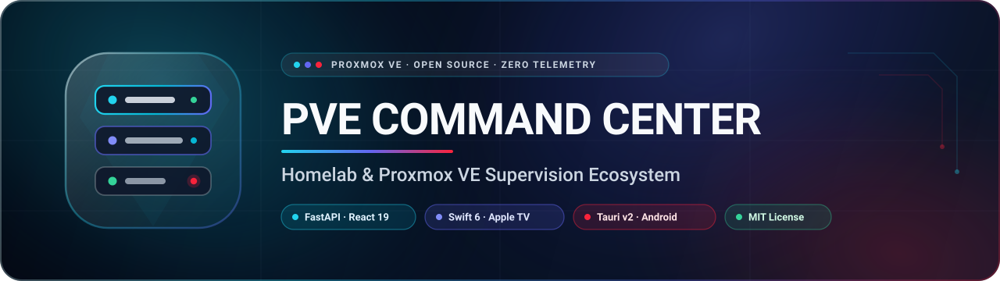

  <a href="https://github.com/Fairy-Jeux/pve-center-website">
    <picture>
      <source media="(prefers-color-scheme: dark)" srcset="../branding/SVG/banner-logo-solid.svg" />
      <source media="(prefers-color-scheme: light)" srcset="../branding/SVG/banner-logo-light.svg" />
      
    </picture>
  </a>

  

    <a href="README.md">🇬🇧 English</a> &nbsp;|&nbsp; <a href="README.fr.md">🇫🇷 Français</a>
  

  

    
    
    
    
  

---

**PVE Command Center** is an open-source, self-hosted **Proxmox VE & homelab supervision ecosystem** built for speed, clarity, and privacy. Designed around a Liquid Glass & Cider Studio interface, it brings real-time node telemetry, LXC/QEMU power actions, MergerFS & SMART disk health, media-stack integrations (Jellyfin, Jellyseerr, Plex, Radarr, Sonarr, Prowlarr, qBittorrent), and stateful multi-channel alerting together across every device you use — from a declarative **[`pve-panel`](https://github.com/Fairy-Jeux/pve-panel)** server and embedded Web UI, to native Apple apps in **[`pve-center-apple`](https://github.com/Fairy-Jeux/pve-center-apple)** (iOS, iPadOS, macOS, tvOS), cross-platform desktop and mobile clients in **[`pve-center-clients`](https://github.com/Fairy-Jeux/pve-center-clients)** (Windows, Linux, Android), and full bilingual documentation in **[`pve-center-website`](https://github.com/Fairy-Jeux/pve-center-website)**.

## Architecture & Repositories

| Repository | Purpose | Stack | Platforms |
|---|---|---|---|
| **[`pve-panel`](https://github.com/Fairy-Jeux/pve-panel)** | Core server, REST / WS / SSE API, SQLite WAL `AlertEngine`, Bonjour mDNS discovery, encrypted pairing relay, embedded Web UI, Docker & `install.sh` | Python 3.12, FastAPI, Pydantic v2, SQLite WAL, React 19, Vite, Tailwind | Linux, Proxmox VE LXC, Docker, Web / PWA |
| **[`pve-center-apple`](https://github.com/Fairy-Jeux/pve-center-apple)** | Native Apple clients featuring Liquid Glass UI, Cider accent themes, MenuBarExtra, Live Operations & 10-foot Apple TV dashboard | Swift 6, SwiftUI, SwiftData, CryptoKit, Network.framework | iOS, iPadOS, macOS, tvOS |
| **[`pve-center-clients`](https://github.com/Fairy-Jeux/pve-center-clients)** | Multi-platform desktop and mobile clients with system tray integration, cleartext LAN support & configurable remote server URL | Tauri v2 (Rust), Capacitor 8, React 19, TypeScript, Vite | Windows, Linux (AppImage / DEB), Android |
| **[`pve-center-website`](https://github.com/Fairy-Jeux/pve-center-website)** | Project showcase, per-platform download hub, Cider theme preview & full EN / FR technical documentation portal | VitePress, Vue 3, Liquid Glass / Cider CSS | Web (GitHub Pages) |

### How the Ecosystem Connects

- **Central Control Plane ([`pve-panel`](https://github.com/Fairy-Jeux/pve-panel))**: Aggregates Proxmox VE API telemetry, `/host_mnt` MergerFS & SMART disk health, 5 extensible custom-service connectors (`http_rest`, `tcp_port`, `icmp_ping`, `json_metrics`, `webhook_ingest`), and broadcasts real-time updates over WebSocket (`/api/ws/events`) and SSE (`/api/events/stream`).
- **Zero-Config Discovery**: Advertises `_pvecenter._tcp.local.` via Bonjour/mDNS and exports `pvecenter://connect` QR onboarding bundles so companion apps discover and connect to your server in seconds.
- **Multi-Channel Alerting**: Persists incident states in SQLite WAL with debouncing, cooldowns, muting, and `DOWN -> UP` auto-recovery, dispatching notifications via **APNs HTTP/2**, **Discord**, **Telegram**, and **generic webhooks** (ntfy, Gotify, Home Assistant).

## Philosophy

- **Zero Telemetry**: Everything runs strictly inside your homelab or Tailnet. PVE Command Center ships no analytics, no tracking beacons, and no cloud SaaS dependencies.
- **DualAuth Security & Encrypted Pairing**:
  - **Tailscale Serve SSO (Loopback)** validates `Tailscale-User-Login` headers against an explicit allowlist.
  - **LAN & Remote Bearer / JWT Auth** verifies constant-time SHA-256 API tokens (`pve_...`), `PBKDF2-HMAC-SHA256` Admin PIN logins, and HS256 JWT sessions, with automatic onboarding lockdown once configured.
  - **ECDH P-256 + AES-256-GCM Pairing** protects ephemeral 6-digit PIN Apple TV onboarding bundles end-to-end (`HKDF-SHA256`) so the relay never inspects plain-text credentials.
- **Open Source MIT**: Every repository in the organization is permissively licensed under the [MIT License](../LICENSE) and welcomes community contributions.

## Community & Getting Started

- **Documentation & Downloads**: Explore the bilingual portal in [`pve-center-website`](https://github.com/Fairy-Jeux/pve-center-website) or install the core server in minutes from [`pve-panel`](https://github.com/Fairy-Jeux/pve-panel).
- **Need Help?**: Read [SUPPORT.md](../SUPPORT.md) for documentation links and troubleshooting guidance.
- **Contributing**: See [CONTRIBUTING.md](../CONTRIBUTING.md) and our [Code of Conduct](../CODE_OF_CONDUCT.md) before opening an issue or pull request.
- **Security**: Please report vulnerabilities privately using [SECURITY.md](../SECURITY.md).
